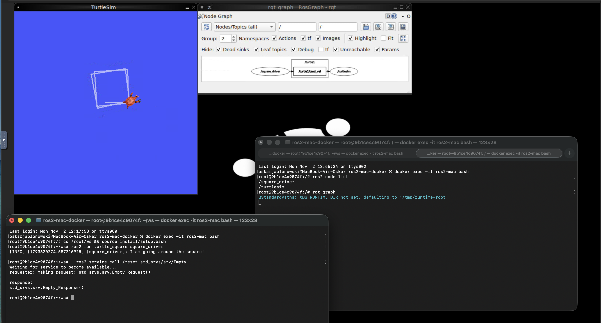
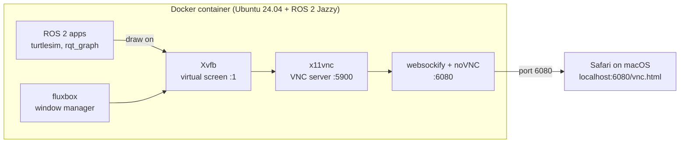
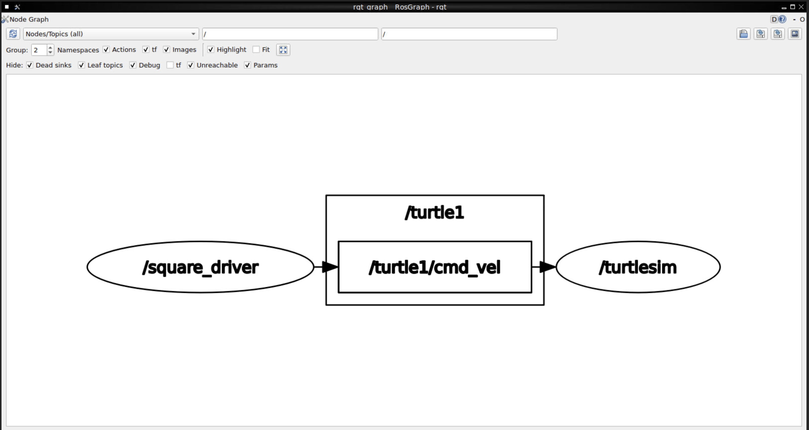
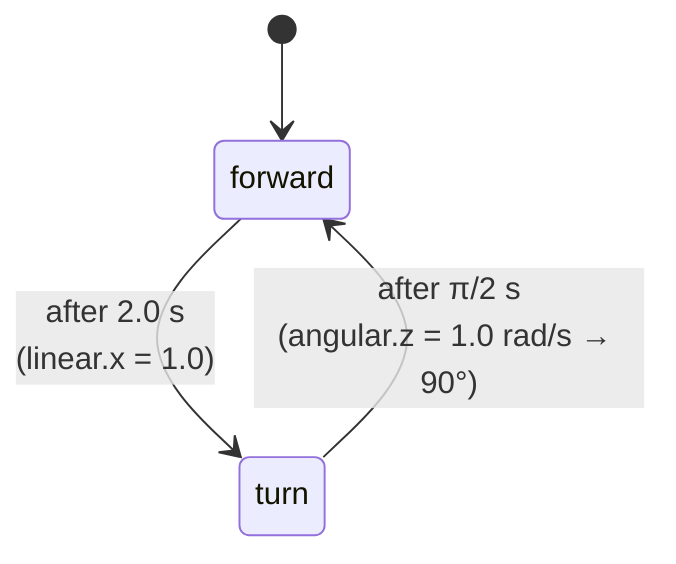
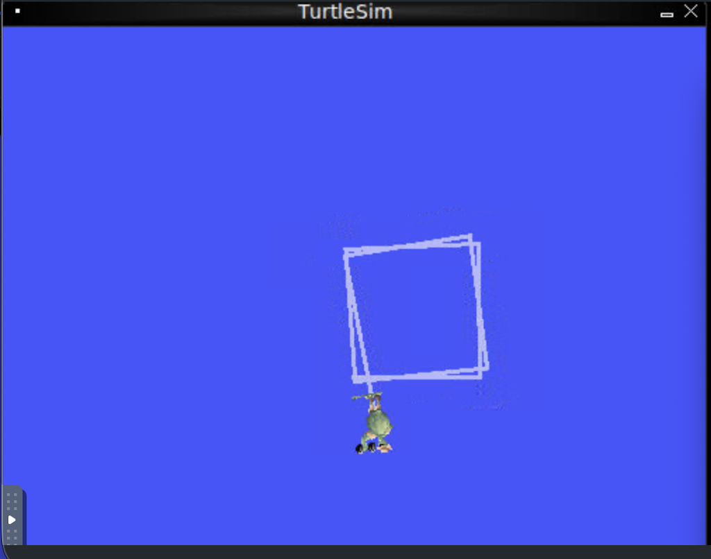

# 🐢 ROS 2 Jazzy on macOS — Docker + noVNC

Run a full ROS 2 Jazzy setup with GUI tools (turtlesim, rqt_graph) on a MacBook with Apple Silicon. **No XQuartz, no VM, no Linux install.** The Linux desktop runs inside a Docker container and is streamed to your browser.

On top of that sits my own ROS 2 node, **`square_driver`**, which drives the turtle in a square.



---

## Why?

ROS 2 targets Ubuntu, and getting GUI apps out of a Docker container on macOS is painful (X11 forwarding, XQuartz, `xhost`, GPU flags…). This repo avoids all of that. The container draws its own virtual screen and you open it in Safari at `localhost:6080`.

The `ros:jazzy` base image is multi-arch, so on an M-series Mac it runs **natively on arm64** with no emulation.

## How it works



| Piece | Role |
|---|---|
| **Xvfb** | Fake monitor in memory, so GUI apps have something to draw on |
| **fluxbox** | Lightweight window manager (lets you move and close windows) |
| **x11vnc** | Shares that screen over VNC |
| **websockify + noVNC** | Turns VNC into a web page, so no VNC client is needed |

## Quick start

**Requirements:** Docker Desktop for Mac (Apple Silicon).

```bash
# 1. Build the image (once)
docker build -t ros2-mac .

# 2. Start the container (the ws/ folder is shared with your Mac)
docker run -it --rm --name ros2-mac -p 6080:6080 -v "$PWD/ws:/root/ws" ros2-mac
```

3. Open **http://localhost:6080/vnc.html** in your browser and click **Connect**.
4. Need more terminals? From a new Mac terminal tab:
   ```bash
   docker exec -it ros2-mac bash
   ```

## Running the square driver

**Terminal 1**: build the workspace and start the simulator:
```bash
cd /root/ws && colcon build && source install/setup.bash
ros2 run turtlesim turtlesim_node
```

**Terminal 2**: run my node:
```bash
cd /root/ws && source install/setup.bash
ros2 run turtle_square square_driver
```

**Terminal 3** (optional): look at the graph:
```bash
ros2 node list      # /square_driver, /turtlesim
rqt_graph
```



## The `square_driver` node

Located in `ws/src/turtle_square/turtle_square/square_driver.py`.

- **Publishes** `geometry_msgs/msg/Twist` on `/turtle1/cmd_vel`
- Runs a **10 Hz timer** with a simple two-state machine:



- Shuts down cleanly on Ctrl+C (`ExternalShutdownException` + `try_shutdown`)



## ROS 2 concepts used

- **Nodes**: `/square_driver` and `/turtlesim`
- **Topics** (continuous stream): `/turtle1/cmd_vel` for velocity commands and `/turtle1/pose` for turtle position
- **Services** (request → response): reset the simulator without restarting it:
  ```bash
  ros2 service call /reset std_srvs/srv/Empty   # clear + turtle back to center
  ros2 service call /clear std_srvs/srv/Empty   # clear the drawing only
  ```
- **Remapping**: drive the turtle by keyboard with a generic teleop node:
  ```bash
  ros2 run teleop_twist_keyboard teleop_twist_keyboard --ros-args -r cmd_vel:=/turtle1/cmd_vel
  ```
- **Workspace + colcon**: `ament_python` package, `colcon build`, `source install/setup.bash`

## Known limitation → next step

The turns are **timed** (open loop), not measured. Each turn lands slightly over or under 90° because the timer ticks every 0.1 s. After a few laps the square slowly **rotates and drifts**.

**Planned fix:** subscribe to `/turtle1/pose` and stop turning when the measured heading has changed by 90° (closed loop).

## Project structure

```
ros2-mac-docker/
├── Dockerfile            # ROS 2 Jazzy + turtlesim, rqt, teleop + VNC stack
├── start-desktop.sh      # starts Xvfb, fluxbox, x11vnc, noVNC
├── docs/                 # screenshots
└── ws/                   # ROS 2 workspace (mounted into the container)
    └── src/turtle_square/
        ├── package.xml
        ├── setup.py
        └── turtle_square/square_driver.py
```

## Troubleshooting

- **rqt_graph shows only `/turtlesim`**: `square_driver` isn't running. Keep it running in its own terminal and press the refresh button in rqt_graph.
- **`XDG_RUNTIME_DIR not set`**: harmless warning, ignore it.
- **Turtle looks different every start**: turtlesim picks a random ROS distro mascot. That's a feature 🙂

## License

MIT